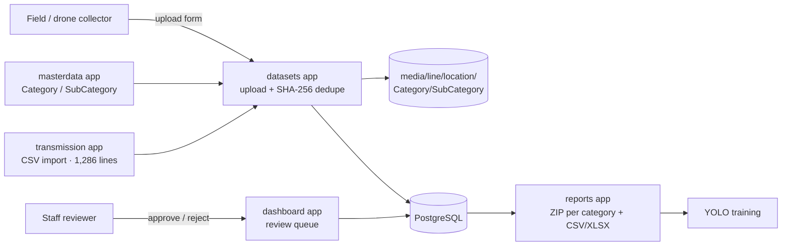

# APTRANSCO Transmission Inspection Dataset Portal

> A Django + PostgreSQL portal that turns scattered drone and field photos of transmission lines into a **clean, deduplicated, reviewed ML training dataset**. It feeds the YOLO models behind APTRANSCO's [AI drone inspection system](https://github.com/karrisubhash/Aptransco-Drone).

[](#)
[](#)
[](#)
[](#testing)

**🔗 Live:** https://dataportal.aptransco.co.in/ (deployed on APTRANSCO's domain; sign-in required)<br/>
**Context:** built during my AI/ML internship at APTRANSCO (May–Jul 2026).

> Full design rationale and decision log: [ARCHITECTURE.md](ARCHITECTURE.md)

---

## Problem

Training defect-detection models needs thousands of labelled images. Before this portal, the images sat in personal folders and WhatsApp exports. The same photo was saved several times under different names, nothing was tied to a line or tower, and nobody could tell which images had been checked. Every training run began with days of manual cleanup.

## What it does

- **Imports transmission-line master data** from CSV: 1,286 lines with voltage, circle and length.
- **Collects images** through one per-location upload form. The Component → Defect taxonomy is data-driven, so new categories need no code change.
- **Organises files on disk automatically** under `media/<line>/<location>/<Category>/<SubCategory>/`.
- **Deduplicates by content**: every upload gets a SHA-256 checksum, so the same photo is never stored twice, whatever its file name. Management commands backfill checksums and report duplicates already on disk.
- **Review workflow** with separate roles for collectors and staff: `Draft → Submitted → Approved / Rejected`.
- **Exports training data**: one ZIP per category containing *approved images only*, plus CSV and Excel metadata.
- **Production hardening**: env-driven settings, refuses to start without `DJANGO_SECRET_KEY` when `DEBUG=False`, WhiteNoise static files, and a `/healthz` probe that checks the DB.

## Architecture



## Tech stack

| Layer | Technology |
|---|---|
| Backend | Python, Django 6.0 |
| Database | PostgreSQL (`psycopg2`) |
| Frontend | Django templates, Bootstrap 5, vanilla JS |
| Data | pandas (CSV import), Pillow, openpyxl (Excel export) |
| Production | WhiteNoise, Waitress / Gunicorn behind a TLS reverse proxy |

## Project structure

```
├── config/          # settings (env-driven), urls, wsgi/asgi, /healthz
├── accounts/        # sign-up / login, role-based landing
├── transmission/    # TransmissionLine model + import_transmission_data command
├── masterdata/      # Category / SubCategory taxonomy + seed_masterdata command
├── datasets/        # Inspection, InspectionImage, upload flow, checksum utils, dedupe commands
├── dashboard/       # "My inspections" + staff review dashboard
├── reports/         # ZIP / CSV / XLSX dataset export
├── templates/  static/
└── ARCHITECTURE.md
```

## Getting started

```bash
python -m venv .venv && source .venv/bin/activate       # Windows: .venv\Scripts\activate
pip install -r requirements.txt
cp .env.example .env                                     # set DB credentials
createdb data_portal
python manage.py migrate
python manage.py seed_masterdata                         # idempotent taxonomy seed
python manage.py import_transmission_data path/to/transmission_data.csv
python manage.py createsuperuser
python manage.py runserver
```

Staff users land on the review dashboard; collectors land on the upload page.

### Environment variables

| Variable | Purpose |
|---|---|
| `DJANGO_DEBUG` | `False` in production (enables security hardening) |
| `DJANGO_SECRET_KEY` | Required when `DEBUG=False` |
| `DJANGO_ALLOWED_HOSTS`, `DJANGO_CSRF_TRUSTED_ORIGINS` | Comma-separated |
| `DJANGO_DB_NAME`, `DJANGO_DB_USER`, `DJANGO_DB_PASSWORD`, `DJANGO_DB_HOST`, `DJANGO_DB_PORT` | PostgreSQL |
| `DJANGO_MEDIA_ROOT` | Image storage root |
| `DJANGO_TIME_ZONE` | Defaults to `Asia/Kolkata` |

## Routes

| Path | Who | Purpose |
|---|---|---|
| `/upload/` | collector | Per-location multi-image upload |
| `/my-inspections/` | collector | Own submissions and their status |
| `/staff/` | staff | Dashboard and review queue |
| `/inspection/<id>/`, `/inspection/<id>/review/` | staff | Detail view, approve / reject |
| `/reports/category/<id>/zip/` | staff | Approved-only dataset ZIP |
| `/reports/metadata.csv`, `/reports/metadata.xlsx` | staff | Metadata export |
| `/healthz` | ops | Liveness and DB check |

## Management commands

| Command | Purpose |
|---|---|
| `seed_masterdata` | Seed / refresh the Component / Defect taxonomy |
| `import_transmission_data <csv>` | Import the line master data |
| `backfill_checksums` | Compute SHA-256 for images uploaded before dedupe existed |
| `find_duplicate_images` | Report images with identical content |

## Testing

```bash
python manage.py test
```

49 tests cover path and dedupe utilities, the upload flow (including duplicate rejection), access control, the review lifecycle and dataset export.

## Screenshots

<!-- TODO(Subhash): add screenshots of the upload form and staff dashboard (no real tower data) -->

## Future improvements

- Store media in S3-compatible object storage and serve signed URLs.
- Export directly in YOLO format (images plus label files and `data.yaml`).
- Detect near-duplicates with perceptual hashing (pHash), not just exact matches.
- Add a REST API so the drone platform can pull approved datasets automatically.
